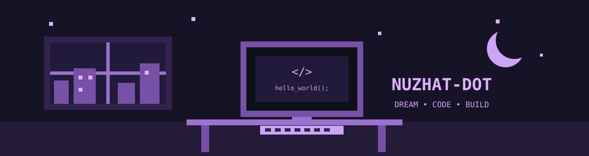
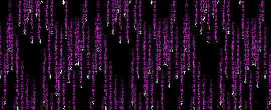

  

  <h1>Hey, I'm Nuzhat! 💜</h1>

  

    
  

---

## 🌷 About Me

- 🎓 Software Engineering Student at IUT
- 💻 Exploring software development and backend engineering
- 🌱 Learning new technologies every day
- 🚀 Building projects and improving my skills

  

  

## 💜 Tech Stack

  

## 🚀 Featured Projects

| Project | Description |
|---|---|
| 🐱 StudyPet | Gamified study companion |
| 🏙️ AmarShohor | Citizen-driven city service platform |
| 📦 TrackChain | Smart supply chain tracking system |

## 📊 GitHub Statistics

  

  

---

  <h3>✨ Dream • Code • Build • Repeat 💜</h3>
  
Thanks for visiting my little corner of GitHub!

  

  

  

